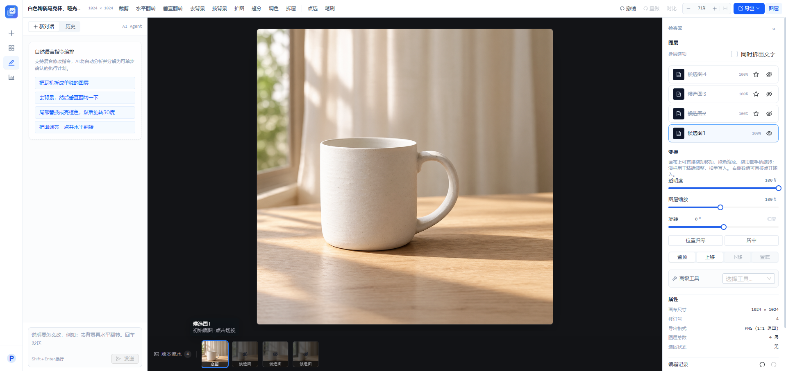
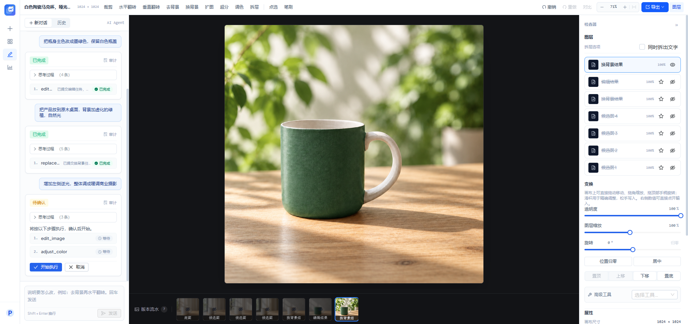
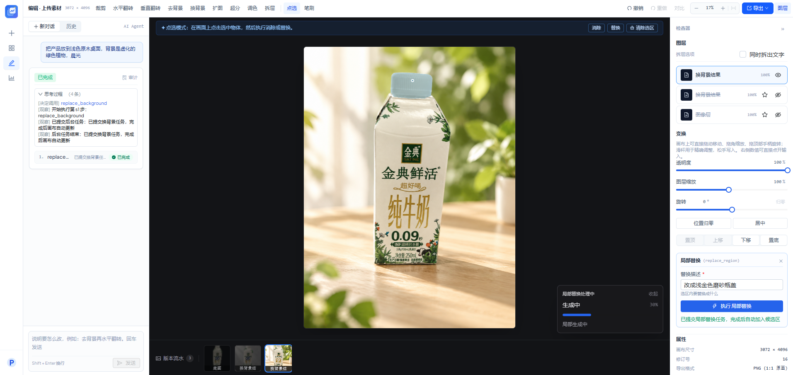
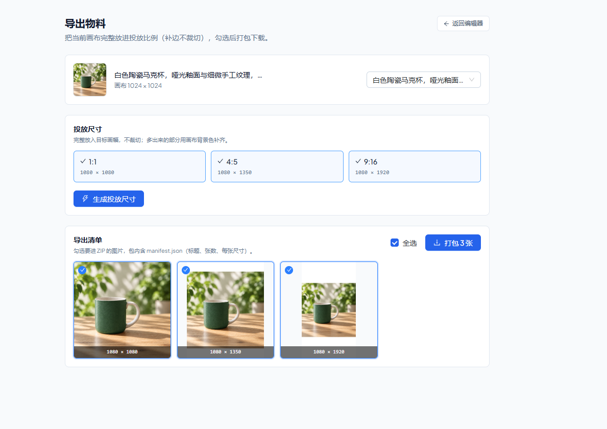

# GraphCanvasAgent（图画智能体）

**用自然语言改图的多图层 AI 编辑器。** React 19 + FastAPI + LangChain/LangGraph + Konva 全栈实现。

不同于"一句话出一张图"的单步工具，这里把修图拆成**可确认的执行计划**：大模型先规划步骤，你点「开始执行」才真正动文档；每一步都落撤销栈，改错了随时退回去。

- 🧠 **Agent 多步规划**：LangGraph 状态机把复合指令拆成有序步骤，规划/执行两段流式可见
- 🎨 **画布即文档**：Konva 渲染，图层级解耦；存结构不存像素，撤销是整份文档快照
- ⚡ **异步任务链路**：耗时操作走 ARQ 排队，SSE 实时回传思维链与进度，画布不阻塞

---

## 界面一览

| 三栏工作台：对话 / 画布 / 检查器 | 多步计划：逐条确认后执行 |
| --- | --- |
|  |  |
| 左侧自然语言对话，中间沉浸式深色画布与版本胶卷条，右侧图层、变换滑杆、属性与编辑记录。左右栏可拖拽调宽。 | 一次指令拆成多个步骤，每步带状态胶囊；「开始执行 / 取消」由你决定，已完成的步骤留在对话里可回看。 |

| 局部编辑：选区 + 排队任务进度 | 物料导出：投放尺寸 + ZIP |
| --- | --- |
|  |  |
| 点选或笔刷圈出区域，交给局部替换/消除；右下角进度卡实时显示各阶段百分比，可收成胶囊不挡画面。 | 按 1:1 / 4:5 / 9:16 完整放入画幅（补边不裁切），勾选后打包 ZIP，内含 `manifest.json` 清单。 |

---

## 核心能力

- **Agent 智能调度**：基于 LangGraph 的图结构状态机，将复杂修图意图拆解为多步执行计划，计划确认后才落地；支持失败步骤重试与整轮取消。
- **思维链可观测**：SSE 推送四类增量（思考 / 决定调用 / 观察 / 反思），规划期间自动展开，收束后折叠成一行摘要。
- **高性能交互画布**：图层拖动/缩放/旋转（绕中心、手柄随缩放补偿）、画布裁剪（八锚点 + 比例约束）、11 参数调色（拖动实时预览，应用才落撤销栈）。
- **全链路多模态工具箱**：27 个原子工具，覆盖文本指令、图层变换、调色、抠图/换背景/扩图/超分、局部重绘（inpainting）、拆层（背景/主体/文字）。
- **物料化交付**：单图画布直出 PNG（1:1 零往返），或生成三档投放尺寸并打包 ZIP。
- **数据看板**：按用户视角统计任务成功率、平均耗时、出图数与 Token 消耗，缺数据的调用明确标注"不估算"。

## 工程取舍

- **存结构不存像素**：`LayerDocument` JSONB 是唯一真相源，像素由前端 Konva 合成；调色/裁剪只改结构。
- **快照式撤销**：每步存 before/after 整份文档，不做反向操作推导——简单、可预期。
- **诚实 UI**：后端没有的能力不渲染按钮；失败不静默消失；图片加载失败画橙色占位而不是让图层凭空消失。
- **契约先行**：工具入参一份 Pydantic Model 三处消费（服务端校验 / LLM schema / 表单元数据）。
- **观测可插拔**：自建 `agent_traces`（五类 span）是真相源；配好 `LANGFUSE_*` 才旁路导出到 Langfuse，不配则完全不联网——离线演示与本地评测都零依赖。

---

## 快速开始

```bash
# 1) 中间件：Postgres 17 / Redis 7 / 对象存储
docker compose up -d

# 2) 后端（依赖可选；CV 体积大，抠图/超分才需要）
cd backend
uv sync --extra dev                     # 或再加 --extra agent / --extra cv
uv run uvicorn app.main:app --port 7402 --reload

# 3) 异步任务 worker（必须与 API 同时跑，再开一个终端）
uv run arq app.worker.WorkerSettings

# 4) 前端
cd frontend
npm install --ignore-scripts             # 本机必须带该参数，见 frontend/README.md
npm run dev                              # http://127.0.0.1:7401
```

打开 <http://127.0.0.1:7401>，落地页会实时显示后端 `/ready` 的三项依赖状态（Postgres / Redis / 对象存储）。

后端读取仓库根的 `.env`（首次 `cp .env.example .env`）。默认 `IMAGE_PROVIDER=mock`：
用本地 Pillow 生成占位图，**不需要任何 API Key** 就能跑通全流程；接真实模型时按注释切
`dashscope` / `openai` 并填 Key（规划模型走百炼 OpenAI 兼容端点）。

> 📌 **端口段 74xx**：前端 7401 / API 7402 / PG 7411 / Redis 7412 / S3 7413-7414。
> 若你的机器上 74xx 已被占用，改 `.env` + `docker-compose.yml` + `frontend/vite.config.ts` 三处即可整体平移。

> ⚠️ **worker 必须挂着**：容器只负责 Postgres / Redis / 对象存储，任务执行在 worker 进程里。
> 少跑它的表现是生成任务永远停在「排队中」——不是接口坏了。

> ⚠️ 本机 `localhost` 会解析到 IPv6 `::1`，而 compose 端口只绑 `127.0.0.1`。
> 环境变量里一律写 `127.0.0.1`，否则 Redis 会连接超时。

## 工程结构

```
backend/    FastAPI：config（必填 fail-fast）/ db / routers / services / tools / agent / providers / tasks / eval
frontend/   React 19：api / domain（画布领域层）/ layouts / hooks / components / pages
docs/       开发计划、前端 UI/UX 分析报告、界面截图
```

## 页面与流程

`/` 公开落地页 → `/login`（可携带 prompt 接力）→ `/create` 创作（生成 + 上传 + 素材一屏）
→ `/candidates/{runId}` 候选图（可刷新可分享）→ `/editor/{sessionId}` 三栏工作台
→ `/editor/{sessionId}/export` 物料导出；侧栏还有 `/assets` 素材库与 `/metrics` 数据看板。

编辑器状态全部进 URL（session / run 可刷新、可分享）；视图状态（缩放、选中、对话）刻意不进文档，不产生撤销记录。

## 开发进度

施工图见 [`docs/开发计划.md`](docs/开发计划.md)。

| 里程碑  | 内容                                                                    | 状态 |
| ------- | ----------------------------------------------------------------------- | ---- |
| M0      | 基建：Docker / compose / 对象存储选型                                    | ✅   |
| M1      | 骨架 + 鉴权（bcrypt + JWT）+ 素材上传（可切换直传模式）                   | ✅   |
| M2      | Provider 抽象 + ARQ 任务队列 + SSE 事件流                                 | ✅   |
| M3      | 编辑会话 + LayerDocument + Konva 画布（存结构不存像素）                   | ✅   |
| M4      | 工具注册表 + `/api/tools` + Agent 单步（一处定义三处消费）                | ✅   |
| M5      | 快照式撤销栈 + 裁剪/翻转 + 调色渲染（alpha 通道保留）                     | ✅   |
| M6–M8   | 选区局部编辑、拆层、多步计划（规划 / 确认 / 重试）                        | ✅   |
| M9      | 差异化：CoT 流式 / 状态机反思 / trace 可观测                              | ✅   |
| M10     | 评测：拒绝率与计划质量指标（本地门禁）                                     | ✅   |
| M11     | 编辑器交互（裁剪/调色/变换）、物料导出、数据看板、素材缩略图               | ✅   |
| 尾巴    | 选区 promote 拆物体、真机浏览器 E2E                                       | ⬜   |

## 文档

- [`docs/开发计划.md`](docs/开发计划.md) —— M0–M11 施工图，含每阶段验收标准与踩坑清单
- [`docs/前端UI-UX分析报告.md`](docs/前端UI-UX分析报告.md) —— 前端布局 / 交互 / 样式体系审计与问题清单
- [`backend/README.md`](backend/README.md) / [`frontend/README.md`](frontend/README.md) —— 各自的分层与命令
